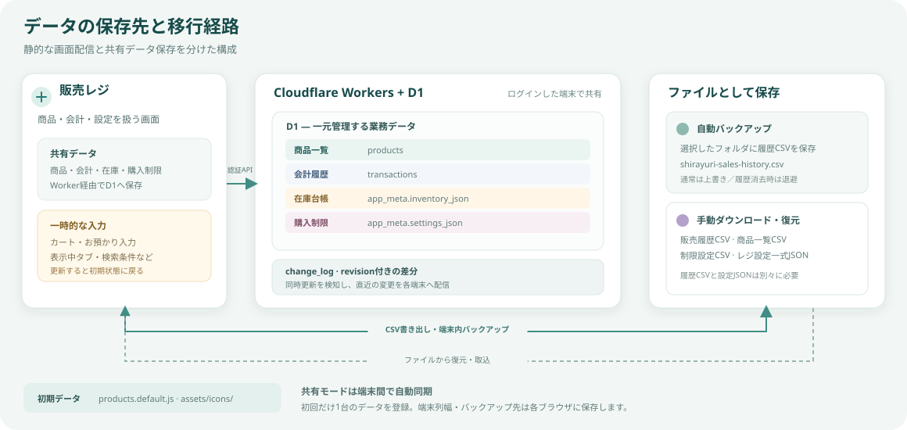

# 販売レジのデータ保存のしくみ

この資料は、アプリのデータがどこに保存され、バックアップや端末移行で何が引き継がれるかをまとめたものです。操作手順ではなく、現行コードの保存仕様を説明します。

図は、共有モードでの端末間同期と、別途行うファイルの書き出し・復元を示します。API接続先を設定していないローカルモードでは、従来どおり各ブラウザ内だけに保存されます。

## 先に要点

- 共有モードでは、商品・会計履歴・在庫・購入制限を**Cloudflare D1**に保存します。GitHub Pagesは画面ファイルを配信し、Cloudflare Workerが認証とD1への読み書きを仲介します。
- 商品列幅・自動バックアップ設定・バックアップ先フォルダなどの端末固有設定は、各ブラウザに残ります。バックアップCSVは選択した端末のフォルダに保存されます。
- D1 APIのURLが未設定ならローカルモードです。URLを設定した状態でサーバーに接続できない場合は、端末内だけに保存して会計確定扱いにすることはありません。
- ローカルモードでは、ブラウザやブラウザープロファイル、アプリのURL（オリジン）が違うと保存データは別になります。
- 会計履歴と在庫台帳は別データです。会計履歴CSVだけでは、通常、実在庫の残数や在庫調整履歴は移りません。
- 端末移行には、**レジ設定一式（JSON）と販売履歴（CSV）の両方**を保存してください。

## どこに保存されるか

| データ                 | 共有モードの保存先 | ローカルモード／補足 |
| ---------------------- | ------------------ | -------------------- |
| 商品一覧               | D1 `products`      | ローカル時は `localStorage` の `shirayuri-products-v1`。ID・カテゴリ・商品名・単価・在庫上限・アイコン。 |
| 会計履歴               | D1 `transactions`  | ローカル時は `shirayuri-transactions-v1`。会計日時、明細、数量、金額、メモなど。 |
| 在庫台帳・購入制限     | D1 `app_meta`      | ローカル時は `shirayuri-inventory-v1` と `shirayuri-settings-v1`。会計履歴とは別に在庫残数を保持します。 |
| 変更履歴               | D1 `change_log`    | 端末間の差分同期用。直近2,000回分を保管し、それより古く離れた端末は全状態を再読込します。 |
| 認証情報               | Cloudflare Worker secrets | 共有パスワードと署名キー。ブラウザへパスワードは保存せず、ログイン用トークンはタブの `sessionStorage` に最大12時間保持します。 |
| 端末固有設定           | ブラウザの `localStorage` / IndexedDB | 商品列幅、自動バックアップ設定、バックアップ先フォルダなど。他端末へは同期しません。 |
| 自動バックアップCSV    | 利用者が選んだフォルダ | `shirayuri-sales-history.csv`。共有DBとは別に、各端末で設定・保管します。 |
| 初期商品・初期アイコン | アプリのファイル     | 初期商品は `products.default.js`、アイコンは `assets/icons/`。GitHub Pagesの画面配信に含まれます。 |

共有モードではブラウザがWorker APIを呼び出し、WorkerがD1へ保存します。会計や商品等の更新は版番号を照合して一括確定します。別端末が先に更新していた場合は古い端末の保存を拒否し、最新状態を取り込んだうえで再操作を求めます。共有の変更は最大15秒間隔またはタブ復帰時に確認します。

ローカルモードの `localStorage` は、ブラウザごと・オリジンごとに分かれます。オリジンとはURLの「スキーム・ドメイン・ポート」の組み合わせです。公開URLとローカルの `index.html`、異なるブラウザ、別プロファイルはそれぞれ別の保存領域になります。

## 会計と在庫の関係

会計を確定すると、サーバー側で会計履歴と在庫台帳を同じD1トランザクションとして更新します。D1への保存成功後にはじめて会計確定とし、通信・競合・保存エラー時はカートを残します。ローカルモードでは、履歴と在庫台帳をブラウザ内で一緒に保存します。

在庫台帳には主に次の値があります。

- `salesByProduct`：商品ごとの累計販売数
- `remainingByProduct`：商品ごとの現在の残数
- `adjustments`：実在庫を手入力で調整した記録（直近50件）

会計履歴を消去しても、商品一覧・レジ設定・在庫台帳は消えません。そのため、履歴を消した後も残数や累計販売数は維持されます。在庫台帳がまだない旧データでは、アプリ起動時に会計履歴から初期台帳を作成します。

## バックアップ形式ごとの違い

| ファイル・方法   | 含まれるもの                                                                     | 含まれないもの／注意点                                                                                                              |
| ---------------- | -------------------------------------------------------------------------------- | ----------------------------------------------------------------------------------------------------------------------------------- |
| 販売履歴CSV      | 会計ごとの明細、日時、単価・数量、合計、お預かり、おつりなど                     | 商品一覧、在庫台帳、レジ設定は含みません。復元すると、現在の会計履歴をCSVの内容で置き換えます。通常は復元先の在庫台帳を維持します。 |
| 商品一覧CSV      | 商品名、カテゴリ、単価、アイコン情報、在庫上限、商品ID                           | 会計履歴、累計販売数、実在庫残数、在庫調整履歴は含みません。                                                                        |
| 制限設定CSV      | 購入制限、商品列幅、自動バックアップの有効・間隔など                             | 商品一覧、会計履歴、在庫台帳、自動バックアップ先フォルダは含みません。                                                              |
| レジ設定一式JSON | 商品一覧、アイコン、在庫上限、在庫台帳、購入制限、商品列幅、自動バックアップ設定 | **会計履歴とバックアップ先フォルダは含みません。** 在庫調整履歴は直近50件です。                                                     |
| 自動バックアップ | 販売履歴CSVを選択フォルダに保存                                                  | 商品一覧、在庫台帳、レジ設定は含みません。ブラウザが対応し、フォルダへのアクセス権がある必要があります。                            |

### 共有モードの初回設定

1. まず一台の端末でログインし、その端末のデータを共有DBの初期データとして登録します。
2. 他の端末の端末内データは自動統合されません。必要なデータがある場合は、初期登録前にどの端末を正本にするか決めてください。
3. 初期登録後は各端末で同じ共有パスワードを使ってログインします。会計履歴・在庫・商品・購入制限はD1から読み込まれます。
4. 共有モードでは販売履歴CSVや設定一式の復元も全端末に反映されます。端末列幅やバックアップフォルダは端末ごとに設定します。

### CSVで端末間を移すとき（ローカルモード）

1. 元の端末で「レジ設定一式」をダウンロードします。
2. 「販売履歴」をCSVでダウンロードします。
3. 新しい端末でレジ設定一式を復元し、続けて販売履歴CSVを復元します。
4. 自動バックアップを使っていた場合は、新しい端末で保存先フォルダを選び直します。

設定一式の復元は商品・在庫・設定を置き換えますが、会計履歴は変更しません。続けて履歴CSVを復元することで、両方を移行できます。反対に、履歴CSVだけを復元しても在庫残数の完全な移行にはなりません。

## 保存されない一時状態

商品を選択中のカート、お預かり入力中の金額、一時的なきょうだい人数、表示中のタブ、集計期間、検索・絞り込み、カテゴリの折りたたみ状態などは、ブラウザ内へ永続保存されません。ページを更新すると初期状態に戻ります。未確定の会計や編集中の内容がある場合に表示される確認は、誤操作を防ぐ警告であり、入力途中のデータをバックアップするものではありません。

## 消える可能性があるケース

- ブラウザの「サイトデータ／Cookieとサイトデータ」を削除する
- プライベートブラウズを終了する
- ブラウザープロファイルを削除・変更する
- ブラウザの保存容量不足や利用制限が起きる

保存機能を利用できない場合、アプリは警告を表示してメモリ上の一時保存に切り替えることがあります。この場合、ページを閉じたり更新したりするとデータは残りません。商品・会計・在庫の保存に失敗した場合も、画面のエラー表示を確認してください。

ブラウザ内のデータを消しても、すでにダウンロードしたCSV／JSONファイルや、選んだフォルダに保存済みのCSVまでは削除されません。反対に、ブラウザ内データはダウンロード済みファイルがあるだけでは自動復元されません。

## 実装の参照先

- `storage.js`：ブラウザ保存キー、読込・保存、データ検証、保存失敗時の復元処理
- `app.js`：会計・在庫・設定の保存タイミング、自動バックアップ、インポート／エクスポート
- `d1-client.js` / `cloudflare/worker.mjs`：共有API、ログイン、D1差分同期と競合防止
- `cloudflare/migrations/`：D1のテーブル定義
- `core.js`：CSV／JSONの形式、在庫計算、レジ設定一式の変換
