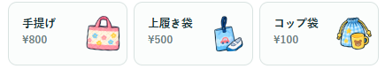
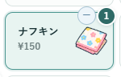
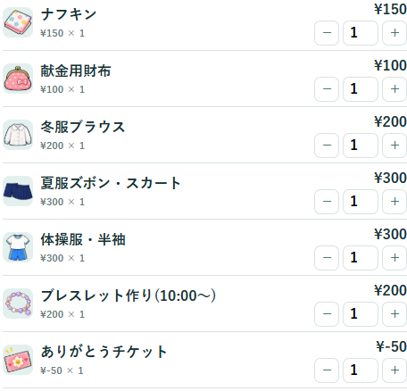
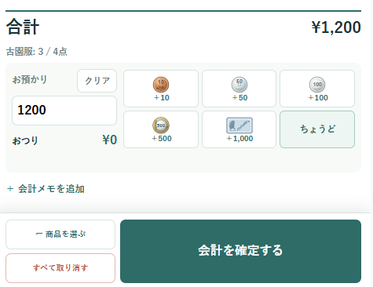
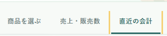
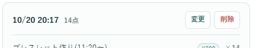
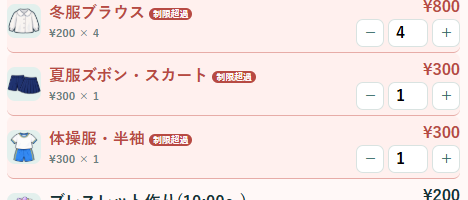
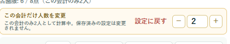
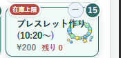
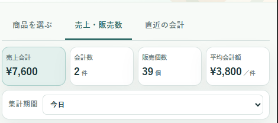

# 白ゆりフェスタ 販売レジ｜かんたんガイド

むずかしい説明は省いて、よく使う操作だけをまとめました。困ったときは、近い項目をご覧ください。

## 🛍️ ふだんのお会計

**🛍️ 商品を選ぶ　→　🔢 個数を確認　→　💴 お預かり　→　🪙 おつりを確認　→　✅ 会計**

1. 商品カードをタップして、会計に追加します。
2. 個数が違うときは「＋／−」で調整します。
3. お預かり金額を入力するか、金額ボタンで加算します。「ちょうど」は合計金額を入力します。
4. おつりを確認して「会計を確定する」を押します。



商品を選ぶと、カードの色と数字で選択数を確認できます。



スマートフォンでは画面下のボタンを押すと、お会計画面が開きます。


お会計画面では、商品名・個数・金額を確認します。「＋／−」で個数を直し、お預かり金額を入力したら「会計を確定する」を押します。





## ↩️ 間違えたとき

- **まだ確定していない**：お会計の「＋／−」で個数を直します。最初からやり直すときは「すべて取り消す」を押します。
- **確定した直後**：画面に「直前の会計を取り消す」が出ていたら押します。
- **あとから間違いに気づいた**：「直近の会計」を開き、該当する会計の「変更」または「削除」を選びます。

「すべて取り消す」を押すと確認画面が出ます。内容を確認してから取り消してください。

「直近の会計」を開き、直したい会計の「変更」を押します。





商品や個数を直すときは「変更」を選び、直したあと「変更を保存」します。「削除」は会計記録そのものを消す操作です。

## ⚠️ 「制限超過」と表示されたら

この会計だけ人数を変えるときは：

**会計画面 →「この会計だけ人数を変更」→ 人数を調整**





いつもの人数設定を変えるときは、**「管理」→「購入制限の設定」**を開きます。

## 🔎 商品が見つからない・残数が足りない

| 👀 商品が見つからない | 📦 残数が足りない |
| --- | --- |
| 「カテゴリ表示」で、カテゴリが隠れていないか確認します。 | 「管理」→「商品管理」で在庫上限や残数を確認します。 |



## 📊 売上や過去の会計を見る

**売上・販売数**で売上を確認。**直近の会計**で会計明細を確認・変更できます。



## 🆘 まずここを確認

| お困りのとき | まずここを確認 |
| --- | --- |
| 会計を確定できない | 商品が選ばれているか、お預かりが合計以上か確認します。「制限超過」や「残り」も見てください。 |
| 別のスマホ・パソコンに商品や会計が出ない | 同じ「共有レジ」に入っているか確認します。分からないときはレジの担当者に聞いてください。 |
| 共有レジに入れない | 園で決めた合言葉（共有パスワード）を確認します。 |
| 会計の記録が見つからない | 「直近の会計」で日付や検索条件を確認します。 |

## 💾 データを消す前に

```text
会計の記録を残す　→「販売履歴をダウンロード」
商品や在庫の設定を残す →「レジ設定をダウンロード」
```

スマートフォンやパソコンを替えるとき、データを消すときは、先にバックアップしてください。操作に迷ったら、消したり戻したりする前にレジの担当者へ相談してください。
