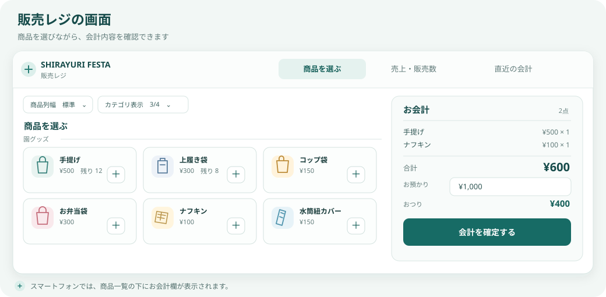
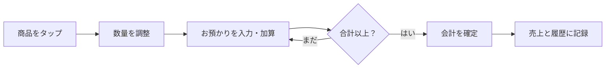

# 白ゆりフェスタ 販売レジ｜使い方ガイド

このガイドでは、商品の選び方から会計、売上の確認、バックアップまでを順番に説明します。

## まずは画面を見てみましょう

商品を選ぶ画面では、商品カードを選び、会計内容を確認できます。パソコンでは商品一覧の横に会計欄が表示されます。スマートフォンでは画面下の合計と「会計に進む」を使い、会計画面を開きます。画面上部の「管理」から、購入制限や商品、バックアップなどを設定できます。

## 会計の流れ

1. 「商品を選ぶ」で商品カードをタップします。パソコンでは横のお会計欄に、スマートフォンでは画面下の合計に明細が反映されます。スマートフォンで詳細を確認するときは「会計に進む」を押してください。
2. 商品カードの「＋／−」または数量欄で個数を調整します。商品を選び直すと数量を増やせます。
3. 「お預かり」に金額を入力するか、「＋10」「＋50」「＋100」「＋500」「＋1,000」で加算します。「ちょうど」を押すと、合計金額が入力されます。
4. おつりを確認し、「会計を確定する」を押します。ボタンが押せないときは、商品が選ばれているか、お預かりが合計以上か、制限や在庫の超過がないかを確認してください。

パソコンでは会計欄の上端のつまみを上下にドラッグして高さを調整できます。スマートフォンの会計画面では明細一覧だけがスクロールし、下部の「会計を確定する」「商品を選ぶ」「すべて取り消す」は固定表示されます。会計を確定すると会計画面は閉じます。

## 商品カードの見方

- 商品名と価格を確認して、カードをタップすると会計に追加できます。
- 在庫上限が設定されている商品には「残り」が表示されます。会計を確定する前でも、いま選んでいる個数を差し引いた残数が分かります。
- 数量バッジは、選択数が0より大きいときに表示されます。
- 「商品列幅」からカードの幅を切り替えられます。「カテゴリ表示」では、表示するカテゴリを選べます。カテゴリ名をタップすると、そのカテゴリの商品を折りたためます。

## 購入制限に引っかかったとき

購入制限は「管理」→「購入制限の設定」で設定します。対象カテゴリ、きょうだい人数、1人あたり上限を指定し、「制限設定を反映」を押してください。設定が保存されると、次の会計から適用されます。

制限超過が表示された場合は、会計欄にある「この会計だけ人数を変更」で人数を調整できます。この変更はその会計だけに適用され、保存済みの購入制限は変わりません。「設定に戻す」を押すと元の設定に戻ります。

## 売上や過去の会計を見る

- 「売上・販売数」では、売上合計・会計数・販売個数・平均会計額を確認できます。「今日」「今週」「今月」「全期間」で期間を切り替え、商品別・カテゴリ別などの分析を見られます。在庫残数グラフでは、上限を設定した商品の残りと消化率を確認できます。
- 「曜日×時間帯の混雑」は、選択中の期間・時間帯ごとの会計件数を色の濃さで比較します。複数日の会計があると、混みやすい曜日・時間帯を見つけやすくなります。
- 「直近の会計」では、会計ごとの明細を確認できます。検索語や期間、カテゴリで絞り込み、「さらに20件表示」で古い会計を追加表示できます。「変更」で会計内容を直して保存し、「削除」でその会計を取り消せます。削除前には確認が表示されます。
- 会計を確定した直後は、画面に表示される「直前の会計を取り消す」を短時間利用できます。誤って確定したときのための操作です。
- 「日次締め」では日付ごとの会計数、売上、お預かり、おつりを確認し、商品別の集計をCSVに出力できます。

## 商品を追加・変更する

1. 画面上部の「管理」を開き、「商品管理」へ進みます。
2. 新しく登録する場合は、カテゴリ・商品名・単価を入力します。在庫上限は必要な場合だけ入力してください。空欄は「無制限」です。
3. 登録済み商品の名前・カテゴリ・単価・在庫上限を変えたら、その商品の「商品情報を反映」を押します。アイコンを変えるときは「画像を変更」を使います。
4. 商品を削除しても、過去の会計履歴は残ります。

商品名の途中でカード表示を改行したい場合は、商品名に `\n` を入れます。例：`夏服\nセーラー`。CSVでまとめて編集する場合は、「商品一覧CSVをダウンロード」で現在の商品を保存し、編集後に「商品一覧CSVを読み込む」から取り込みます。Excelのファイル（`.xlsx`）は直接読み込めないため、CSV UTF-8またはTSVで保存してください。

### 在庫上限について

在庫上限は、商品ごとの**全会計を通じた累計販売数**に対して適用されます。たとえば上限が20個で、これまでに7個販売済みなら、残りは13個です。上限を空欄にすると無制限になります。残り3個以下になると、商品カードで注意表示されます。

実際の在庫数とずれた場合は、「管理」→「商品管理」の「実在庫の残数」に現在の残数を入力し、「残数を反映」を押します。調整内容は最近の在庫調整に記録されます。会計履歴を消去しても在庫残数は維持され、会計の削除・変更時には販売数に応じて残数が戻ります。「販売済みをリセット」は会計履歴を残したまま、現在の残数を新しい販売期間の初期在庫として販売済みを0に戻します。共有モードでは全端末に反映されます。

## データを守る・別の端末へ移す

保存方法は、共有サーバー（Cloudflare Worker + D1）の接続設定によって異なります。現在の `api-config.js` が空欄の場合は端末内保存モードです。この場合、商品・会計履歴などは利用中のブラウザに保存され、別の端末やブラウザへは同期されません。ブラウザのデータを消す前に、下記のバックアップを行ってください。

共有サーバーを設定した場合は、画面に表示される「共有レジにログイン」で共通パスワードを入力します。商品、会計履歴、在庫、購入制限はD1に保存され、ログインした端末間で共有されます。他端末の変更は通常15秒以内、またはページに戻ったときに反映されます。ログインの有効期限が切れた場合は、再度ログインしてください。

共有モードの「管理」を開くときは、共有ログイン用とは別の管理者パスワードの入力が必要です。商品追加・変更・削除、在庫残数の調整、販売済みのリセット、購入制限の変更、設定の復元、販売履歴の削除など、他の端末に影響する操作は管理者だけが実行できます。Cloudflare Workerでは、共有ログイン用を`APP_PASSWORD`、管理者用を`ADMIN_PASSWORD`として登録します。

初回ログイン時に共有データがまだない場合、この端末の商品・会計履歴・在庫・購入制限を共有データとして登録する確認が表示されます。初回登録に使う端末は1台だけにしてください。複数端末のデータは自動で合算されません。共有データが既にある状態で端末内データと異なる場合、共有データで置き換える確認が表示されます。端末にしかない履歴や商品を残す場合は、先にバックアップしてから切り替えてください。

共有サーバーを利用中も、商品列幅や自動バックアップの設定・保存フォルダは端末ごとです。通信できないときは共有データを保存できず、会計も確定されません。別端末が先に更新した場合は最新データが読み込まれるので、内容を確認して操作をやり直してください。

### 販売履歴をバックアップする

「管理」→「販売履歴のバックアップ」で操作します。

- **販売履歴をダウンロード**：現在表示中の会計履歴をCSVで保存します。共有サーバーを利用中は、共有データのバックアップになります。定期的な手動バックアップにおすすめです。
- **販売履歴を復元**：CSVの内容で、現在の会計履歴を置き換えます。共有サーバーを利用中は、復元結果も他のログイン端末に共有されます。実行前に確認が表示されます。復元するCSVを間違えないようにしてください。
- **販売履歴を消去**：会計履歴だけを消去します。商品一覧・設定・在庫残数は消えません。消去前に確認が表示されます。

自動バックアップを使うには、「自動バックアップを有効にする」→保存先フォルダを選択→間隔を選択→「自動バックアップ設定を保存」の順に操作します。指定したフォルダの `shirayuri-sales-history.csv` に、選んだ間隔で上書き保存されます。自動処理中はアプリの画面を開いたままにしてください。フォルダへの自動保存に対応していないブラウザでは利用できず、アプリ内に案内が表示されます。バックアップ状況には最終保存日時が表示され、24時間以上保存されていない場合は注意が出ます。必要に応じて手動ダウンロードも併用してください。

### レジ設定を別の端末へ移す

端末内保存モードでは、「設定の移行・バックアップ」から「レジ設定をダウンロード」すると、商品・アイコン・購入制限・現在の在庫残数などをまとめて保存できます。新しい端末では「レジ設定を復元」でファイルを読み込みます。この設定ファイルに**販売履歴とバックアップ先フォルダは含まれません**。販売履歴は別途CSVで保存・復元してください。共有サーバーを利用する場合、ログイン後に共有データが読み込まれるため、このファイルでの端末間移行は通常不要です。

## ページを閉じる・更新する前に

未確定の会計や編集中の内容があると、ページを更新・終了するときに確認が表示されます。内容を確定するか、取り消してから移動してください。大切な会計を入力した直後は、確定後に「直近の会計」へ記録されたことを確認すると安心です。

## 困ったときは

| 状況                           | まず確認すること                                                                           |
| ------------------------------ | ------------------------------------------------------------------------------------------ |
| 会計を確定できない             | 商品を選んだか、お預かりが合計以上かを確認します。購入制限・在庫上限も確認してください。   |
| 商品が見つからない             | 「カテゴリ表示」でそのカテゴリが表示対象になっているか確認します。                         |
| 残数が0になった                | 在庫上限に達しています。管理画面の商品管理で上限を確認してください。                       |
| 実際の在庫と表示が違う         | 商品管理の「実在庫の残数」を更新し、「残数を反映」を押してください。                       |
| 共有レジのログイン画面が出ない | `api-config.js` にWorkerのURLが設定されているか確認します。空欄の場合は端末内保存モードです。 |
| 共有レジにログインできない     | パスワード、通信状態、Workerの公開状態を確認します。ログイン画面のエラーも確認してください。 |
| 別端末で更新が反映されない     | 同じ共有レジにログインしているか、通信状態を確認します。通常15秒以内に反映されます。          |
| 別端末で履歴が出ない           | 端末内保存モードでは自動同期されません。共有サーバーを設定するか、CSVでバックアップ・復元してください。 |
| 別の端末が更新したと表示される | 最新データが読み込まれています。画面の内容を確認してから、もう一度操作してください。          |
| 自動バックアップを設定できない | ブラウザの対応状況を確認し、難しい場合は「販売履歴をダウンロード」で手動保存してください。 |
